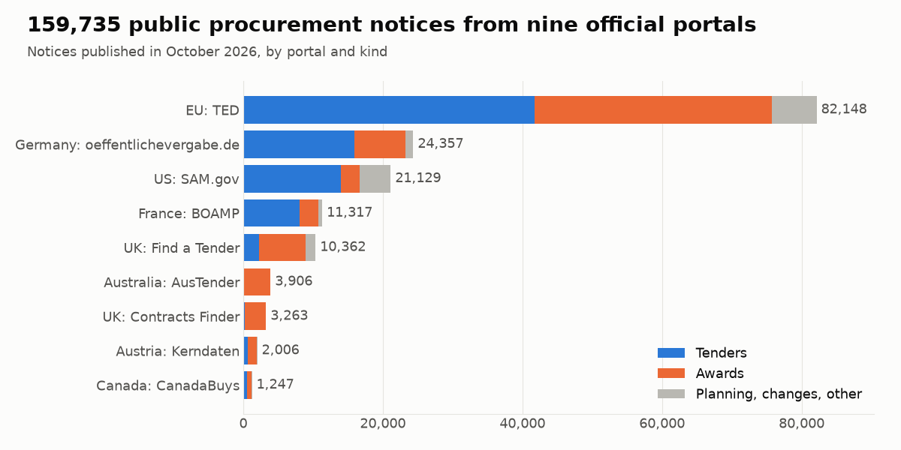

# Government tenders data

Free sample datasets of public procurement notices, as CSV and Parquet, with their columns and known limits.

| Dataset | What it is | Rows |
|---|---|---|
| [Government tenders and contract awards, October 2026](data/tenders-2026-10) | Tender and award notices from 9 official portals (EU, UK, US, Germany, France, Austria, Canada, Australia) in one schema | 159,735 |



## Load it

```python
import pandas as pd
url = "https://raw.githubusercontent.com/Malodar/government-tenders-data/main/data/tenders-2026-10/tenders_metadata.csv.gz"
tenders = pd.read_csv(url, low_memory=False)
print(tenders.groupby(["source", "notice_category"]).size())
```

The file with the full notice text (`tenders_full.parquet`, 76 MB) is attached to the
[2026-10 release](https://github.com/Malodar/government-tenders-data/releases/tag/2026-10).

The same dataset is on Kaggle: [Government Tenders and Awards, October 2026](https://www.kaggle.com/datasets/artsiomkunitsyn/government-tenders-and-awards-october-2026).
Starter notebook: [What did governments buy in October 2026?](https://www.kaggle.com/code/artsiomkunitsyn/what-did-governments-buy-in-october-2026)

## Get the full, current data

This is a snapshot of one month. The same data up to yesterday, with filters for country, CPV or NAICS code, keywords and contract value, comes from the [Government Tenders Scraper](https://apify.com/artsiom_k/government-tenders-scraper) on Apify (pay per result). [Tender Alerts](https://apify.com/artsiom_k/tender-alerts) returns only the new notices that match your saved searches. `examples/` shows how to run it from Python.

More of my scrapers: https://apify.com/artsiom_k

## License

Code: MIT (`LICENSE`). Data: CC BY 4.0 for the compilation (`data/LICENSE`), and each row keeps the licence of its
source. The credit lines the sources ask for are in [`NOTICE.md`](NOTICE.md).
