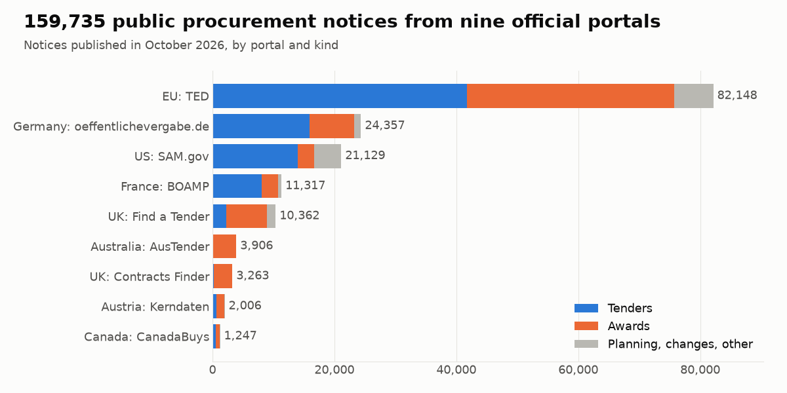

# Government tenders and contract awards, October 2026

159,735 public tender and contract award notices published in October 2026 on nine official procurement portals: the EU's TED, the United Kingdom, the United States, Germany, France, Austria, Canada and Australia. One schema for all of them, values converted to euro, and stable ids that link buyers, winners and the notices of one procedure.

**First look:** 83,397 tenders and 62,276 contract awards. The median awarded contract is worth EUR 253,758, and 82% of notices carry a CPV code.

## Files

- `tenders_metadata.csv.gz`: all 159,735 rows, without the long text columns; lists are joined with `; `
- `tenders_sample_500.csv`: 500 random rows of the same table, to look at in the browser
- `sources.csv`: the nine portals with their row counts, licences and credit lines
- `tenders_full.parquet` (all columns, with the notice text): attached to the
  [2026-10 release](https://github.com/Malodar/government-tenders-data/releases/tag/2026-10)

## Sources

| source | name | coverage | notices | licence |
|---|---|---|---|---|
| ted | TED (Tenders Electronic Daily) | EU and EEA, above-threshold notices | 82,148 | CC BY 4.0 |
| de_oeffentlichevergabe | Bekanntmachungsservice (oeffentlichevergabe.de) | Germany, including notices below the EU threshold | 24,357 | CC0 1.0 |
| sam_gov | SAM.gov Contract Opportunities | United States, federal | 21,129 | US government work (public domain) |
| fr_boamp | BOAMP | France, including notices below the EU threshold | 11,317 | Licence Ouverte 2.0 (Etalab) |
| uk_find_a_tender | Find a Tender | United Kingdom, higher-value notices | 10,362 | Open Government Licence v3.0 |
| au_austender | AusTender | Australia, federal contract awards | 3,906 | CC BY 3.0 AU |
| uk_contracts_finder | Contracts Finder | United Kingdom, lower-value notices | 3,263 | Open Government Licence v3.0 |
| at_kerndaten | Kerndaten (data.gv.at) | Austria, mostly contract awards, including below threshold | 2,006 | CC BY 4.0 |
| ca_canadabuys | CanadaBuys | Canada, federal tenders and awards | 1,247 | Open Government Licence - Canada 2.0 |

## Columns

| Column | Meaning |
|---|---|
| `source` | Which portal the notice comes from (see `sources.csv`) |
| `external_id` | Unique id of the row: source and the portal's notice id |
| `notice_id` | The portal's own notice id |
| `url` | Link to the notice on the portal |
| `title` | Title, in English where the portal gives one |
| `title_original` | Title in the original language, when different (Parquet only) |
| `description` | Notice text (Parquet only) |
| `notice_category` | `tender`, `award`, `planning`, `modification`, `cancellation` or `other` |
| `notice_type` | The portal's own notice type |
| `status` | The portal's status, where it gives one |
| `published_at` | Publication date |
| `updated_at` | Date of the last change |
| `deadline` | Deadline for offers; local time at the buyer when no offset is given |
| `buyer_name` | Contracting authority |
| `buyer_department` | Department or end user inside the authority |
| `buyer_country` | Buyer's country, ISO 3166-1 alpha-2 |
| `buyer_city` | Buyer's city |
| `cpv_codes` | EU Common Procurement Vocabulary codes, main code first |
| `naics_codes` | NAICS codes (SAM.gov) |
| `psc_code` | US Product Service Code (SAM.gov) |
| `main_category` | `works`, `supplies` or `services` |
| `procedure_type` | Procedure, such as open or restricted |
| `set_aside` | US small-business set-aside (SAM.gov) |
| `place_of_performance` | Where the contract is carried out |
| `estimated_value` | Estimated value in the original currency |
| `estimated_value_currency` | Currency of the estimated value |
| `award_value` | Awarded value in the original currency |
| `award_currency` | Currency of the awarded value |
| `award_date` | Date of the award decision |
| `winners` | Names of the winning suppliers |
| `solicitation_number` | The buyer's own reference number |
| `procedure_id` | The portal's id of the procedure the notice belongs to |
| `language` | Language of the notice text |
| `licence` | Reuse licence of the row's source |
| `buyer_id` | Stable id of the buyer across notices and sources |
| `winner_ids` | Stable ids of the winners, in the order of `winners` |
| `procedure_key` | Links the notices of one procedure (tender, award, changes) |
| `estimated_value_eur` | Estimated value in EUR at the ECB reference rate |
| `award_value_eur` | Awarded value in EUR at the ECB reference rate |
| `document_urls` | Links to tender documents (Parquet only) |

## How it was collected

From each portal's official open-data service (APIs and bulk files, not page scraping), normalised into one
schema. Snapshot taken on 2026-11-12.

## Personal data removed

The portals publish contact persons with most notices. They are not in this dataset: there are no contact name, phone or e-mail columns. E-mail addresses and phone numbers inside titles and descriptions were replaced with `[email removed]` (10,682 times) and `[phone removed]` (3,446 times) by automatic rules. This is best effort: a name or a locally written phone number can remain in the free text, and a winner can be a sole trader named as a person, as the award notice publishes it. If you find a name, please open an issue.

## Known limits

- **One month, by publication date.** A tender published in October 2026 is here; its award published later is not.
- **Notices overlap between portals.** Large German, French and Austrian contracts appear on TED and on the national portal, so counting rows double-counts them. `buyer_id` is usually the same on both.
- **SAM.gov rows are those still active in early November 2026.** The US extract carries active notices and drops archived ones, so some October notices are missing.
- **Australia is contract awards only**, and Austria is mostly awards.
- **Values are as published.** Some are placeholders (1 EUR) or plainly wrong (hundreds of billions). Zero and negative values were emptied; nothing else was corrected.
- **`deadline` has no time zone** for France, Canada and some others: it is local time at the buyer.
- **Titles are in the original language** except where the portal provides English (TED).

## Full and current data

This is a snapshot of one month. The same data up to yesterday, with filters for country, CPV or NAICS code, keywords and contract value, comes from the [Government Tenders Scraper](https://apify.com/artsiom_k/government-tenders-scraper) on Apify (pay per result). [Tender Alerts](https://apify.com/artsiom_k/tender-alerts) returns only the new notices that match your saved searches.
